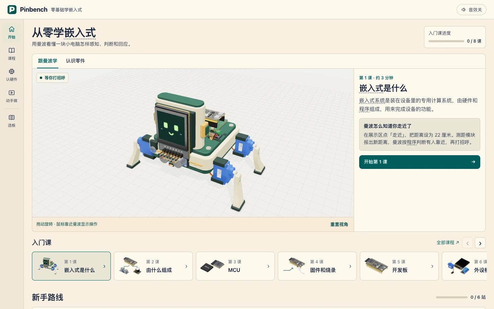
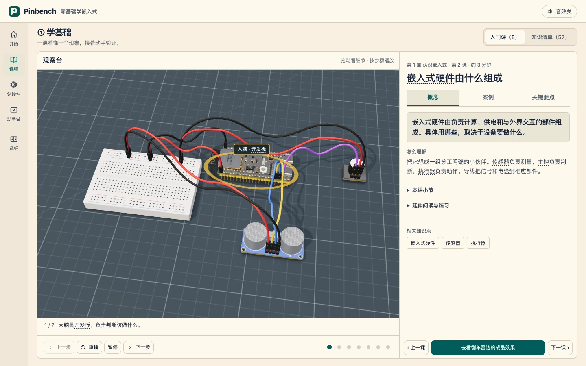

# Pinbench · 零基础学嵌入式

在浏览器里转动 3D 开发板、找引脚、接导线，看小灯怎么亮。Pinbench 把嵌入式入门课、硬件图解和接线实验放在一个网页里，适合自学和课堂演示。

[在线体验](https://pinbench-3d-workshop.vercel.app/) · [下载单文件 HTML](https://github.com/think2do/pinbench-3d-workshop/blob/main/index.html) · [报告问题](https://github.com/think2do/pinbench-3d-workshop/issues)

## 从哪里开始

| 入口 | 可以做什么 |
| --- | --- |
| [跟曼波学](https://pinbench-3d-workshop.vercel.app/#home) | 鼠标移近或在手机上轻点曼波，打招呼、看它摆腿，或调整模拟距离观察它的反应。在「认识零件」里查看主控、测距模块、麦克风、屏幕、舵机和扬声器。 |
| [学基础](https://pinbench-3d-workshop.vercel.app/#learn) | 8 节入门课，从认识嵌入式和微控制器，到供电、接线和写程序。跟着分步 3D 演示操作，再用 57 条[知识清单](https://pinbench-3d-workshop.vercel.app/#learn/kb)查名词。 |
| [认硬件](https://pinbench-3d-workshop.vercel.app/#hardware) | 旋转、缩放开发板和模块，查看零件用途、引脚说明和接线示例。想按项目选板，可以到[选开发板](https://pinbench-3d-workshop.vercel.app/#choose)对照参数。 |
| [动手做](https://pinbench-3d-workshop.vercel.app/#lab) | 8 个引导作品，从闪灯、自动小夜灯做到倒车雷达和桌面温湿度计。也可以自由搭建，或做「找错挑战」，练习排查接反、漏接地线、接错引脚和电平不匹配。 |

第一次使用，可以从第 1 课「嵌入式是什么」开始，再试做第 1 个作品「会闪的提示灯」。实验里可以复制接线和需求提示词，交给自己使用的 AI 工具。页面内的示例程序和烧录效果是浏览器本地演示。

## 离线使用

下载并双击 `index.html`。使用支持 WebGL 的浏览器即可，Three.js r160、课程内容、模型和示例都已内嵌。学习进度和自由搭建记录保存在当前浏览器。

曼波的听声互动需要浏览器麦克风权限，在本地检测有无声音。麦克风不可用时，仍可打招呼或用距离滑块触发反应。接线和烧录练习在网页里模拟。

## 项目与许可

由 **Huang Xiyuan · 且曼学院** 创建，在 [think2do](https://github.com/think2do) 开源。项目代码采用 [MIT 许可证](LICENSE)。曼波的真人招呼来自 Wyang 的[普通话录音《你好吗》](https://commons.wikimedia.org/wiki/File:Zh-cmn-%E4%BD%A0%E5%A5%BD%E5%97%8E.opus)，由原文件转码为 MP3，采用 [CC BY-SA 3.0](https://creativecommons.org/licenses/by-sa/3.0/)。
